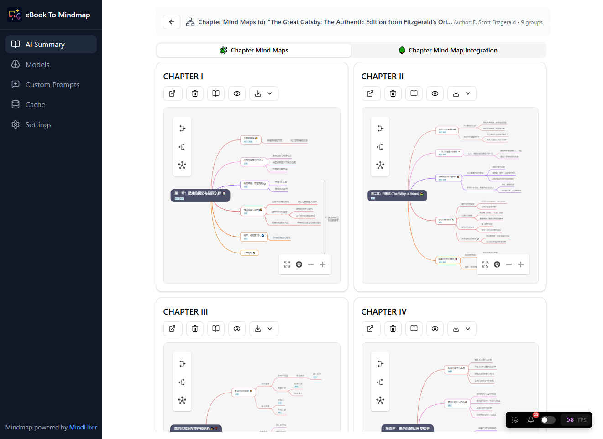

<p align="center">
  <a href="https://ebook2me.mind-elixir.com/" target="_blank" rel="noopener noreferrer">
    
  </a>
  <h1 align="center">E-book to Mind Map</h1>
  <p align="center"><strong>厚い本を薄く読み、真の知識をたやすく</strong></p>
</p>

[中文](README.md) | [English](README.en.md) | 日本語



AI 技術を活用したインテリジェントな電子書籍解析ツールで、EPUB および PDF 形式の電子書籍を構造化されたマインドマップとテキスト要約に変換します。

公式サイト: https://app.mind-elixir.com/en/ebook-to-mindmap

今すぐ試す: https://ebook2me-next.mind-elixir.com/

旧バージョンを使う: https://ebook2me.mind-elixir.com/

## 💡 NotebookLM との比較

Google NotebookLM を使ったことがあれば、電子書籍を処理する際のいくつかの制約に気づいたかもしれません。このツールはそうした課題を解決するために設計されており、よりプロフェッショナルで柔軟な電子書籍の読書とマインドマップ作成の体験を提供します。

| 機能                       | 本ツール (ebook-to-mindmap)                                                                                                                                                                                                | Google NotebookLM                                                                                                                                                                                              |
| :---------------------------- | :-------------------------------------------------------------------------------------------------------------------------------------------------------------------------------------------------------------------------- | :------------------------------------------------------------------------------------------------------------------------------------------------------------------------------------------------------------- |
| **マインドマップのエクスポートと編集** | 🛠️ **エクスポートして編集可能**: オンライン画面は閲覧専用ですが、**マインドマップをデータファイルとしてエクスポート**し、Mind Elixir デスクトップクライアントやその他のエディターに取り込んで、自由に編集・修正できます。 | ❌ **エクスポートも編集も不可**: マインドマップは閲覧専用で、エクスポートできず、後からの編集にも一切対応していません。                                                                                |
| **プロンプトの柔軟性**        | 🎯 **完全なカスタマイズ**: カスタムプロンプトに対応し、システムプロンプトを完全に置き換える「カスタムプロンプトのみ使用」モードも用意しています。AI はあなたの指示を忠実に守ります。                                                  | 🚫 **システムプロンプトが強すぎる**: 主に検索と要約 (RAG) 向けに最適化されています。組み込みのシステムプロンプトの影響が非常に強いため、独自のカスタム指示に完全には従えません。 |

## ✨ 機能

### 📚 複数フォーマットに対応

- **EPUB ファイル**: EPUB 形式の電子書籍の解析と処理に完全対応
- **PDF ファイル**: 目次ベースおよびスマートな章抽出による、インテリジェントな PDF ドキュメント解析

### 🤖 AI によるコンテンツ処理

- **複数の AI サービス**: Google Gemini と OpenAI GPT モデルに対応
- **2 つの設定モード**: 自分の API Key を設定する方法 (BYOK モード) と、Mind Elixir アカウントにログインして組み込みモデルを使う方法 (キー不要オプション) に対応
- **BYOK モード**: 自分の API Key を使用します (Bring Your Own Key)。すべての AI リクエストはブラウザから AI プロバイダーへ直接送信されるため、データの安全性とプライバシーが完全に守られます
- **キー不要オプション**: Mind Elixir アカウントで直接ログインし、組み込みのホスト型モデルを使用します (スター/星星算力を消費)。API Key の設定は不要で、すぐに使えます
- **3 つの処理モード**:
  - 📝 **テキスト要約モード**: 章ごとの要約を生成し、章同士の関係を分析して、書籍全体の要約を出力します
  - 🧠 **章別マインドマップモード**: 章ごとに独立したマインドマップを生成します
  - 🌐 **全体マインドマップモード**: 書籍全体の内容を 1 つの包括的なマインドマップに統合します

### 💾 効率的なキャッシュ機構

- **スマートキャッシュ**: AI の処理結果を自動的にキャッシュし、処理が中断されても前回の位置から再開できます
- **キャッシュ管理**: ストレージ容量を節約するため、モードごとにキャッシュを消去できます
- **オフライン閲覧**: 処理済みのコンテンツはオフラインで閲覧できます

### 🎨 モダンなインターフェース

- **レスポンシブデザイン**: さまざまな画面サイズに対応します
- **リアルタイムの進捗表示**: 処理の各ステップをリアルタイムで可視化します
- **インタラクティブなマインドマップ**: ズーム、ドラッグ、ノードの展開/折りたたみに対応します
- **コンテンツプレビュー**: 章の元の内容を閲覧できます

## 📖 ユーザーガイド

### 1. AI サービスを設定する

初回利用時は AI サービスの設定が必要です。次の 2 つの方法に対応しています。

#### 方法 1: BYOK モード (Bring Your Own Key)

> **🔒 プライバシー保護に関する注意**: このツールは自分の API Key を使う方法 (Bring Your Own Key) に対応しています。すべての AI リクエストはブラウザから AI プロバイダー (Google または OpenAI) へ直接送信され、サードパーティのプロキシや中継サーバーを経由することは一切ないため、データの安全性とプライバシーが守られます。

1. 「設定」ボタンをクリックします
2. AI サービスプロバイダーを選択します。お試しには **Google Gemini** がおすすめです
3. 対応する API Key を入力します
4. モデルを入力します

##### API Key の取得

**Google Gemini** を例にします。

1. [Google AI Studio](https://aistudio.google.com/) にアクセスします
2. Google アカウントでサインインします
3. 新しい API Key を作成します
4. API Key をコピーして設定に貼り付けます

AI プロバイダーの選択肢について詳しくは、[無料・有料 AI API 選択ガイド](https://ssshooter.com/en/ai-services-guide/) を参照してください。

##### CORS (クロスオリジン) の問題について

BYOK モードではすべての AI リクエストがブラウザから AI プロバイダーへ直接送信されるため、一部のプロバイダーはクロスオリジンリソース共有 (CORS) のレスポンスヘッダーを設定していない場合があります。その場合、リクエストがブラウザの同一オリジンポリシーによってブロックされ、Web 版では利用できなくなります。

**見分け方**: `F12` を押してブラウザの開発者ツールを開きます。Console または Network パネルに `CORS policy` や `blocked by CORS` といった赤いエラーが表示されていれば、この問題です。

**解決策**: この場合は **デスクトップアプリ** に切り替えてください。デスクトップアプリはブラウザの同一オリジンポリシーを適用せず CORS の制限を受けないため、すべてのプロバイダーに正常に接続できます。

#### 方法 2: キー不要オプション (スター / 星星算力) 🌟 おすすめ

AI プロバイダーの API Key を持っていない場合や、複雑な設定を省きたい場合は、Mind Elixir アカウントでログインして **組み込みのホスト型モデル (スター)** を使用できます。

- ⚡ **すぐに使える**: API Key の設定は不要です。ログインするだけで使えます。
- 🪙 **従量課金**: スター残高から差し引かれます。
- 🔄 **アプリ間で共有**: スター残高は Mind Elixir アプリのエコシステム全体で共有されます (例: [M10C ブラウザ拡張機能](https://github.com/SSShooter/M10C-Video-Summary) でも共有されます)。
- ⏳ **有効期限なし**: 購入または獲得したスター残高は期限なく永久に有効です。

_スターのチャージや管理は、[Mind Elixir ウェブサイト](https://app.mind-elixir.com/recharge) にアクセスしてください。_

[](https://app.mind-elixir.com/)

### 2. 電子書籍ファイルをアップロードする

1. 「EPUB または PDF ファイルを選択」ボタンをクリックします
2. 処理する電子書籍ファイルを選びます
3. 対応フォーマット: `.epub`、`.pdf`

[Project Gutenberg](https://www.gutenberg.org/) や [Standard Ebooks](https://standardebooks.org/) などのサイトから無料の電子書籍を入手できます。

### 3. 処理オプションを設定する

設定ダイアログで処理パラメーターを設定します。

#### 処理モード

- **テキスト要約モード**: テキスト要約が必要な場面に適しています
- **章別マインドマップモード**: 章ごとに独立したマインドマップを生成します
- **全体マインドマップモード**: 書籍全体の統合されたマインドマップを生成します (書籍の内容が長すぎると、モデルのコンテキスト不足により失敗する場合があります)

#### 書籍の種類

- **フィクション**: 小説や物語の本に適しています
- **ノンフィクション**: 教科書、参考書、技術書などに適しています

#### 詳細オプション

- **スマート章検出**: 有効にすると、AI を使って章の境界をインテリジェントに識別します
- **無関係な章をスキップ**: 序文、目次、謝辞などを自動的にスキップします
- **サブ章の深度**: サブ章を抽出する階層の深さを設定します (0-3)

### 4. 章を抽出する

1. 「章を抽出」ボタンをクリックします
2. システムが自動的にファイルを解析し、章の構造を抽出します
3. 抽出が完了すると、章の一覧が表示されます
4. 処理する章を選択できます

#### 章のグループ化 (任意)

内容が多岐にわたる書籍では、複数の小さな章を 1 つのグループにまとめて処理することで、より構造化された結果を得られます。グループ化すると、AI はそれらの章の内容をまとめて分析します。

1. **章を選択**: 章の一覧の項目 (チェックボックス部分以外) をクリックして選択します。複数選択にも対応しています。選択された章は枠線がハイライト表示されます。
2. **タグを追加**:
   - 一覧上部の「タグを追加」ボタンをクリックします
   - またはショートカット `Ctrl + G` を使います
3. **グループ名を入力**: 表示されたダイアログでグループ名 (例: 「第 1 部」、「第 1 章」など) を入力します。確定すると、選択した章が同じグループとしてマークされます。
4. **グループを解除**: 章の一覧で既存のタグの後ろにある「X」アイコンをクリックすると、その章のグループ化を解除できます。

### 4.5. カスタムプロンプト (上級)

「カスタムプロンプト」ページで自分専用のプロンプトを管理し、書籍の処理時に使うことで、ニーズにより合った結果を得られます。

1. **プロンプトを管理**:
   - ナビゲーションバーの「カスタムプロンプト」をクリックして管理ページに入ります
   - 「プロンプトを追加」をクリックして新しいプロンプトテンプレートを作成します
   - 名前、説明、プロンプトの具体的な内容を入力します
   - 既存のプロンプトの編集、コピー、削除に対応しています

2. **プロンプトを使用**:
   - 章を抽出した後の設定画面の下部にある「カスタムプロンプト」オプションを探します
   - ドロップダウンメニューから事前に作成したプロンプトを選択します
   - **カスタムプロンプトのみ使用**: チェックすると、あなたのプロンプトがシステムのデフォルトプロンプトを完全に置き換えます (このオプションは **テキスト要約モード** にのみ適用されます)。チェックしない場合、あなたのプロンプトは補足の指示として AI に送信されます。

### 5. 処理を開始する

1. 選択した章を確認します
2. 「処理を開始」ボタンをクリックします
3. システムが処理の進捗と現在のステップを表示します
4. 完了すると結果が表示されます

### 6. 結果を確認する

選択した処理モードに応じて、さまざまな種類の結果を確認できます。

#### テキスト要約モード

- **章ごとの要約**: 各章の詳細な要約
- **章同士の関係**: 章と章の論理的な関係の分析
- **書籍の要約**: 書籍全体の中心となる内容の要約

#### マインドマップモード

- **インタラクティブなマインドマップ**: ズームやドラッグが可能なマインドマップ
- **ノードの詳細**: ノードをクリックすると詳細な内容を表示します
- **エクスポート機能**: 画像やその他の形式でのエクスポートに対応します

## 🛠️ 技術アーキテクチャ

### コア技術スタック

- **フロントエンドフレームワーク**: React 19 + TypeScript
- **ビルドツール**: Vite
- **デスクトップ**: Tauri 2 (Windows / macOS / Linux 向けパッケージ)
- **スタイリング**: Tailwind CSS + shadcn/ui
- **状態管理**: Zustand
- **ファイル解析**:
  - EPUB: @smoores/epub + epubjs
  - PDF: pdfjs-dist
- **マインドマップ**: mind-elixir
- **AI サービス**:
  - Google Gemini: @google/generative-ai
  - OpenAI: 独自実装

## 💻 ローカル開発とデプロイ

同じフロントエンドで **Web** と **デスクトップ** の両方のビルドに対応しています。

### 必要環境

- Node.js 20+
- [pnpm](https://pnpm.io/) 9+
- デスクトップビルドの場合: [Rust](https://www.rust-lang.org/tools/install) と [Tauri の前提条件](https://v2.tauri.app/start/prerequisites/)

### Web

```bash
# Install dependencies
pnpm install

# Dev server (http://localhost:5173)
pnpm dev

# Production build (output: dist/)
pnpm build

# Preview production build
pnpm preview
```

または Docker を使う場合:

```bash
docker compose up
```

### デスクトップ (Tauri)

```bash
# Development mode (Vite + native window)
pnpm tauri:dev

# Package installers (output: src-tauri/target/release/bundle/)
pnpm tauri:build
```

主な成果物: Windows `msi` / `nsis`、macOS `dmg` / `app`、Linux `deb` / `AppImage`。

## 📄 ライセンス

このプロジェクトは MIT License の下でライセンスされています。詳細は [LICENSE](LICENSE) ファイルを参照してください。

## 🙏 謝辞

以下のオープンソースプロジェクトに感謝します。

- [React](https://reactjs.org/)
- [Vite](https://vitejs.dev/)
- [Tailwind CSS](https://tailwindcss.com/)
- [shadcn/ui](https://ui.shadcn.com/)
- [mind-elixir](https://github.com/ssshooter/mind-elixir-core)
- [PDF.js](https://mozilla.github.io/pdf.js/)
- [epub.js](https://github.com/futurepress/epub.js/)

---

ご質問やご提案がありましたら、Issue を送信するか、開発者にご連絡ください (WeChat👇)


